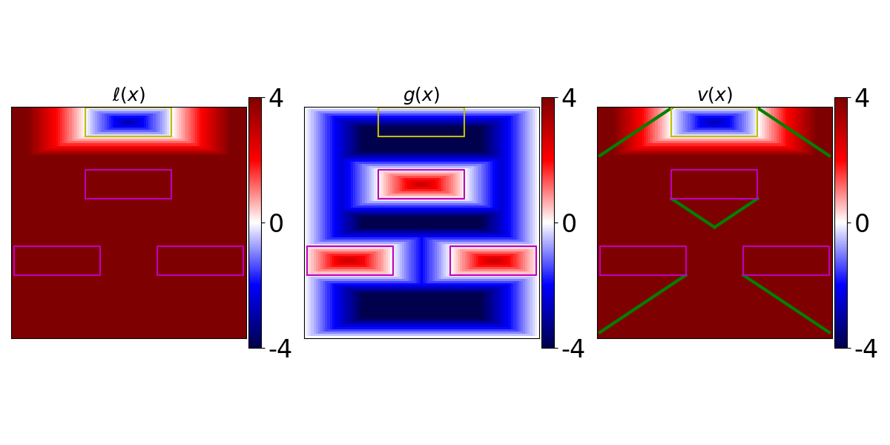
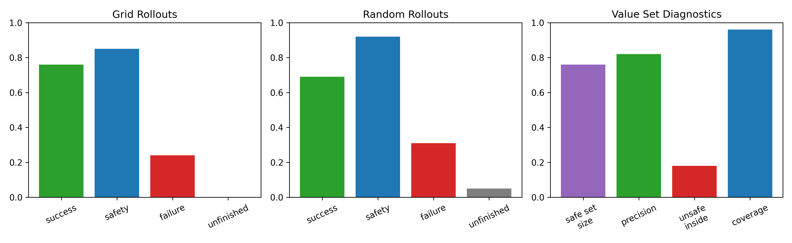

# DDQN for Reach-Avoid Reinforcement Learning

Double Deep Q-Network (DDQN) training for 2D reach-avoid navigation. The project implements a Gym-style Zermelo environment, replay-buffer training, target-network updates, heuristic Q warm-up, and a discounted reach-avoid Bellman update.

The agent minimizes a cost/margin formulation: reaching the target is favorable, entering an unsafe set is unfavorable, and unfinished rollouts are reported separately. The environment supports static zones and time-varying target/obstacle sets.



## What is included

```text
RARL/                                      DDQN and supporting components
gym_reachability/gym_reachability/         ZermeloShowEnv and margin utilities
sim_naive.py                               training and evaluation entry point
experiments/                               local experiment outputs (ignored by Git)
docs/images/                               selected, lightweight visualizations
requirements.txt                           direct Python runtime dependencies
```

### Architecture

```text
sim_naive.py
    ├── gym.make("zermelo_show-v0")
    │      └── ZermeloShowEnv
    └── DDQNSingle
           ├── Model (online and target Q-networks)
           ├── ReplayMemory
           └── DRABE / DDQN update
```

`sim_naive.py` is the only command-line entry point. `RARL/DDQNSingle.py` implements the reach-avoid update and training loop; `RARL/DDQN.py` provides shared schedulers, replay handling, checkpoint restore, and target-network updates. `gym_reachability/.../zermelo_show.py` defines the state dynamics, discrete controls, target and constraint margins, rollouts, and plotting helpers.

## Installation

The source currently uses the older four-return Gym API (`observation, reward, done, info`) and imports the local environment directly from the repository layout. Use a virtual environment and run commands from this directory.

```bash
python -m venv .venv
source .venv/bin/activate                 # Windows PowerShell: .venv\Scripts\Activate.ps1
python -m pip install --upgrade pip
python -m pip install -r requirements.txt
```

The repository has been syntax-checked with `python -m compileall`. A full runtime smoke test requires the dependencies above; the capture environment used to prepare this repository did not have `gym` installed, so runtime training was not claimed as independently reproduced here.

## Train

From the repository root:

```bash
python sim_naive.py --name smoke --outFolder experiments --maxUpdates 1000 --checkPeriod 200
```

The long options above map to the parser in `sim_naive.py`; the script's defaults are intentionally conservative for the original experiments (`maxUpdates=5000000`, `checkPeriod=400000`, warm-up and gamma annealing enabled, figures stored). For a shorter local run, explicitly set smaller update and evaluation periods as in the example.

Useful options include:

| Option | Meaning | Source default |
| --- | --- | ---: |
| `--mode` | `RA` or `lagrange` training mode | `RA` |
| `--doneType` | episode termination policy, e.g. `toEnd`, `TF`, or `fail` | `toEnd` |
| `--timeVarying` / `--staticZones` | moving or static target/obstacle sets | time-varying |
| `--timeHorizon` | time horizon for time-varying episodes | `12.0` |
| `--warmupIter` | heuristic Q warm-up iterations | `2000` |
| `--maxUpdates` | maximum gradient updates | `5000000` |
| `--checkPeriod` | evaluation/checkpoint interval | `400000` |
| `--gamma` | initial/contraction coefficient | `0.9999` |
| `--architecture` | hidden-layer widths | `256 128` |
| `--noWarmup` | disable Q warm-up | off |
| `--noAnnealing` | disable gamma annealing | off |
| `--noStoreFigure` | disable saved plots | off |

The output path is constructed as:

```text
<outFolder>/naive/DDQN/<mode>/<name>/
├── model/Q-<step>.pth
├── figure/*.png
└── train.pkl
```

Training checkpoints and pickle files are deliberately ignored by the repository's Git configuration because they can be large, machine-specific, and unsafe to publish by default.

## Evaluate a checkpoint

Evaluation uses the same output folder and loads a `Q-<step>.pth` file from its `model/` directory. `--loadStep -1` selects the latest available checkpoint.

```bash
python sim_naive.py \
  --evalOnly \
  --outFolder experiments \
  --name smoke \
  --loadStep -1 \
  --evalTraj 100
```

Evaluation writes an `eval_report-<step>.txt`, `eval-<step>.pkl`, and summary figures. Metrics include success/liveness, safety, failure/violation, unfinished rollouts, mean steps to success/failure, and value-set diagnostics.

## Available visual evidence

The checked-in image in `docs/images/` is a lightweight copy of an existing experiment visualization. The local tree also contains historical figures under `experiments/`; those are not treated as a benchmark because their exact command line, seed, hardware, and dependency versions are not fully recorded.



One existing evaluation report is retained locally and records a smoke evaluation of checkpoint `Q-70.pth` with 5 random and 4,961 grid rollouts. Its numbers are historical artifacts, not a new reproducibility claim.

## Thesis context

The accompanying B.Tech project report is titled *Reach-Avoid Reinforcement Learning with Time-Varying Safe and Target Zones* (Ajan Muthuraj, IIT Madras, 08 May 2026). It motivates the time-augmented state `[x, y, t]`, the DRABE objective, DDQN training, and safety/liveness evaluation used by this codebase.

The executable `show` configuration in `ZermeloShowEnv` matches the report's two thin-wall, time-varying-obstacle setup: obstacles move with a sinusoidal horizontal offset and the target moves independently. The class also contains `basic` and `easy` configurations with three rectangular constraints, but `sim_naive.py` currently hardcodes `envType='show'`; those configurations are not exposed as command-line experiments without a code change.

The thesis PDF is intentionally not included in the public repository. It contains institutional material and a limitations-of-use notice; publish it separately only after confirming the author's and institution's redistribution permissions.

## Project status and limitations

- The project is a research/teaching implementation, not a packaged library.
- The thesis was inspected locally but is not a repository artifact; thesis-reported results are not presented here as independently reproduced results.
- The code uses legacy Gym APIs; Gymnasium compatibility has not been asserted.
- Dependencies are listed as direct runtime requirements rather than a fully locked environment because the supplied virtual environments are Windows-specific and are excluded from publication.
- No dataset is required by the training script; experiments are generated procedurally by the environment.

## References

The source tree contains local research PDFs. They are excluded from the public repository unless their redistribution rights are confirmed. Add a citation or DOI here when the intended reference metadata and permissions are available.

## License

No license was present in the supplied project. Until the author chooses one, all rights remain with the copyright holder and reuse should be treated as permission-required.
